# Bima Audit AI — Architecture

Discharge-desk auditor for Indian health-insurance bills. This document is the
pre-code blueprint required by the build spec (§1.2): data flow, schema, i18n
layout and folder structure.

## 1. System & security data flow

```mermaid
flowchart LR
  subgraph Browser["Browser (PWA)"]
    CAM[Camera / file picker] --> MB1[Magic-byte check<br/>src/lib/security/magic-bytes.ts]
    MB1 --> BRUSH[Redaction brush<br/>auto-blur header band]
    BRUSH --> OCRT[OCR text]
    OCRT --> PII[PII scrubber<br/>src/lib/security/pii-scrubber.ts]
    PII -->|redacted text + alias map stays local| API
    UI[Case view / Wallet card / SLA pill] --> ENG[Rules engine<br/>src/lib/rules-engine/evaluate.ts]
  end

  subgraph Edge["Next.js route / Supabase Edge Function"]
    API[/api/scan/] --> RL[Token-bucket rate limit<br/>10 scans / 15 min / user + IP]
    RL --> MB2[Magic-byte + 15 MB check]
    MB2 --> PII2[PII scrubber again<br/>defence in depth]
    PII2 --> WRAP["Wrap in &lt;untrusted_bill_ocr&gt;"]
    WRAP --> LLM[(LLM provider)]
    LLM --> ZOD[Zod: enum-only output<br/>suggested_list, department_code]
  end

  subgraph DB["Supabase Postgres"]
    RULES[(irdai_rules<br/>versioned, bilingual)]
    CASES[(cases / bill_items)]
    EV[(events<br/>append-only, SHA-256 chain)]
    ST[(Storage: private bucket<br/>hospital/case/uuid)]
  end

  ZOD -->|suggestions only, never flags or ₹| CASES
  RULES --> ENG
  CASES --> ENG
  ENG -->|flags + ₹ computed deterministically| UI
  UI -->|remap / confirm| EV
  ST -->|signed URL, 60 s TTL, after RLS check| UI
```



**Trust boundaries**

| Boundary | Control |
|---|---|
| Bill file → app | Magic bytes (`%PDF-`, `FF D8 FF`, `89 50 4E 47`), 15 MB cap, SVG/HTML/ZIP rejected |
| App → LLM | PII scrubbed twice (client + server); OCR wrapped in `<untrusted_bill_ocr>`; output is Zod enum keys only |
| LLM → money | The model never sets `flag` or rupees. Only `evaluate.ts` does, from `irdai_rules` |
| Tenant ↔ tenant | RLS on every table: `auth.jwt() ->> 'hospital_id' = hospital_id::text` |
| History | `events` is append-only with a `pgcrypto` hash chain, verified client-side |
| Raw documents | Private bucket, 60 s signed URLs, purged after 72 h by `pg_cron` |

## 2. Database

See [`supabase/migrations/0001_init.sql`](../supabase/migrations/0001_init.sql)
(schema, RLS, hash-chain trigger, purge job) and
[`supabase/seed/irdai_rules.sql`](../supabase/seed/irdai_rules.sql).

Tables: `hospitals`, `users`, `policies`, `cases`, `bill_items`, `irdai_rules`,
`rule_synonyms`, `events`, `documents`, `case_claim_tokens`.

## 3. i18n layout

```
src/i18n/messages/
  en.json        # en-IN — desk terminology + plain.* family-mode strings
  hi.json        # hi-IN — same keys, regulatory Hindi + सरल भाषा under plain.*
src/lib/i18n/
  dictionary.ts  # key lookup, {var} interpolation, fallback to en
src/lib/store.tsx  # instant switch, localStorage + users.preferred_locale
```

Key namespaces: `nav.*`, `status.*`, `rule.*`, `sla.*`, `wallet.*`, `case.*`,
`dept.*`, `consent.*`, `rebuttal.*`, `plain.*` (family plain-language variants of
`status.*`/`rule.*`/`sla.*`). Rule-specific text lives in the database
(`explanation_en/hi`, `rebuttal_template_en/hi`), not in the JSON files.

## 4. Folder structure

```
src/
  middleware.ts                # session refresh, sign-in redirect
  app/
    layout.tsx  page.tsx       # discharge queue (desk) / my cases (family)
    login/  auth/callback/  claim/
    case/[id]/page.tsx         # case view: SLA pill, Wallet card, grouped bill
    case/[id]/rebuttal/page.tsx# printable rebuttal: en | hi | dual
    api/scan/                  # validate → scrub → model suggestions
    api/cases/[id]/evaluate/   # engine writes flags and payable amounts
    api/cases/[id]/lines/      # desk adds reviewed lines
    api/documents/[id]/        # 60-second signed URLs
  components/
    ios.tsx                    # Group, Row, Squircle, Segmented, Sheet, Toggle
    case/                      # SlaPill, WalletTrapCard, BillRow, LineSheet, ReviewSheet, UploadFlow…
  lib/
    rules-engine/              # types, catalogue, match, prorata, evaluate, rebuttal
    security/                  # pii-scrubber, magic-bytes, rate-limit, audit-chain
    ai/                        # schema, prompt, bill-reader, credentials, fake-reader
    data/                      # Backend interface, demo + Supabase implementations
    supabase/  server/  demo/  i18n/
    store.tsx                  # app state over the Backend interface
  i18n/messages/{en,hi}.json
public/
scripts/                       # seed generators
supabase/migrations/  supabase/seed/  supabase/tests/
docs/
```

## 5. Proportionate deduction formula

```
proportion = (non-differential billing OR package billing) ? 1
           : min(1, room_cap_per_day / actual_room_rent_per_day)

room line payable        = min(actual_rate, cap) × days
exempt line payable      = billed                (pharmacy, implant, device, diagnostics, icu)
associated line payable  = billed × proportion   (nursing, surgeon, OT, consultation, procedure…)
disputable on a line     = max(0, tpa_deducted − legally_deductible)
```
